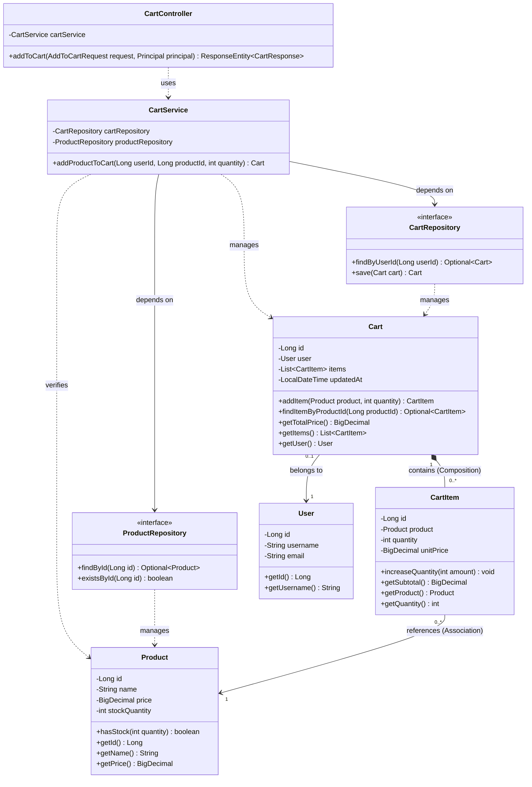
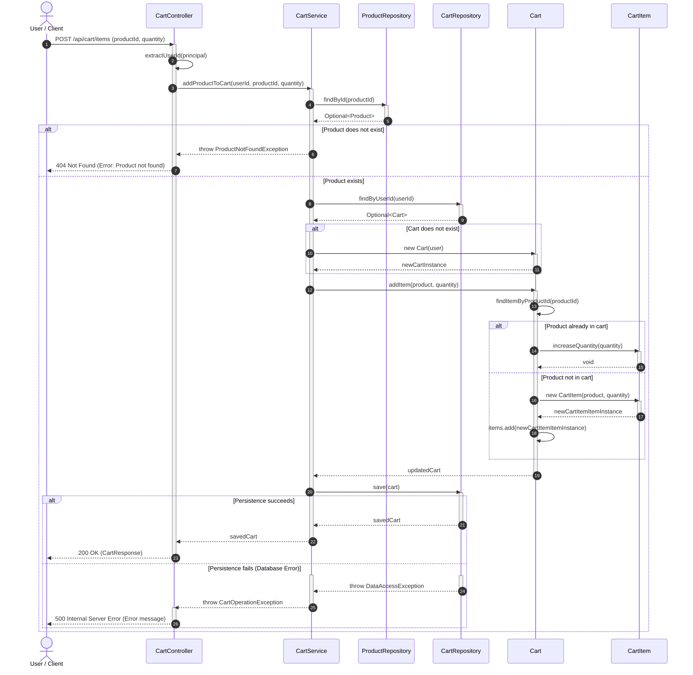

# THIẾT KẾ TÍNH NĂNG: THÊM SẢN PHẨM VÀO GIỎ HÀNG (ADD TO CART)
---

## 1. TỔNG QUAN THIẾT KẾ

Tính năng **"Thêm sản phẩm vào giỏ hàng"** được thiết kế tuân theo các nguyên lý OOP cốt lõi và mô hình kiến trúc phân lớp tiêu chuẩn:
- **Nguyên lý Đóng gói (Encapsulation):** Đối tượng `Cart` tự chịu trách nhiệm quản lý danh sách `CartItem` của nó thông qua phương thức `addItem(product, quantity)`, tránh mô hình phản mẫu *Anemic Domain Model* (mô hình miền thiếu sinh khí).
- **Phân tách trách nhiệm (Separation of Concerns):**
  - **Presentation Layer (`CartController`):** Nhận request, xác thực danh tính từ context, gọi service và định dạng response HTTP.
  - **Business / Application Layer (`CartService`):** Điều phối luồng nghiệp vụ giữa các repository và domain entities.
  - **Data Access Layer (`ProductRepository`, `CartRepository`):** Trừu tượng hóa việc truy xuất cơ sở dữ liệu.
  - **Domain / Entity Layer (`Cart`, `CartItem`, `Product`, `User`):** Chứa dữ liệu nghiệp vụ và các quy tắc nội tại của đối tượng.

---

## 2. CLASS DIAGRAM (SƠ ĐỒ LỚP)

### 2.1. Mã nguồn Mermaid

### 2.2. Phân tích chi tiết các lớp & trách nhiệm

| Tên lớp / Interface | Tầng kiến trúc | Trách nhiệm chính |
| :--- | :--- | :--- |
| **`CartController`** | Presentation | Tiếp nhận HTTP Request thêm sản phẩm, trích xuất an toàn `userId` từ phiên xác thực (`Principal`), gọi tầng Service và ánh xạ kết quả/lỗi thành HTTP Response. |
| **`CartService`** | Application / Service | Điều phối luồng nghiệp vụ: kiểm tra sự tồn tại của sản phẩm, nạp hoặc khởi tạo giỏ hàng người dùng, ủy quyền thêm sản phẩm cho thực thể `Cart`, và lưu trữ qua Repository. |
| **`ProductRepository`** | Data Access | Interface định nghĩa các phương thức truy xuất dữ liệu sản phẩm (`Product`) từ hệ cơ sở dữ liệu. |
| **`CartRepository`** | Data Access | Interface định nghĩa các thao tác lưu trữ, cập nhật và tìm kiếm đối tượng `Cart` theo người dùng. |
| **`Cart`** | Domain Entity | Đại diện cho giỏ hàng. Quản lý danh sách các mục hàng (`CartItem`). Phương thức `addItem(...)` tự kiểm tra nếu mục hàng đã có thì tăng số lượng, nếu chưa thì tạo mục hàng mới. |
| **`CartItem`** | Domain Entity | Đại diện cho từng dòng sản phẩm trong giỏ hàng, lưu trữ số lượng và đơn giá tại thời điểm thêm vào giỏ. |
| **`Product`** | Domain Entity | Đại diện cho sản phẩm kinh doanh (ID, tên, đơn giá niêm yết, số lượng tồn kho). |
| **`User`** | Domain Entity | Đại diện cho tài khoản người dùng sở hữu giỏ hàng. |

### 2.3. Mối quan hệ và Multiplicity
1. **`Cart` và `CartItem` (Composition - `*--`)**: Quan hệ sở hữu chặt chẽ. Mỗi `Cart` chứa `0..*` `CartItem`. Vòng đời của `CartItem` hoàn toàn phụ thuộc vào `Cart`; khi `Cart` bị hủy thì các `CartItem` bên trong cũng bị hủy.
2. **`CartItem` và `Product` (Association - `-->`)**: Mỗi dòng `CartItem` tham chiếu tới đúng `1` thực thể `Product`. Một sản phẩm có thể xuất hiện trong nhiều `CartItem` của nhiều giỏ hàng khác nhau (`0..*`).
3. **`Cart` và `User` (Association - `-->`)**: Mỗi `Cart` gắn với `1` `User`. Một người dùng có tối đa `0..1` giỏ hàng hiện hành.
4. **`CartController` và `CartService` (Dependency - `..>`)**: Controller phụ thuộc vào Service để thực thi logic.
5. **`CartService` và Repositories (Aggregation / Dependency Injection - `-->`)**: Service phụ thuộc vào các interface lưu trữ dữ liệu thông qua cơ chế tiêm phụ thuộc (Dependency Injection).

---

## 3. SEQUENCE DIAGRAM (SƠ ĐỒ TUẦN TỰ)

### 3.1. Mã nguồn Mermaid

### 3.2. Giải thích chi tiết luồng nghiệp vụ

1. **Nhận request và xác thực người dùng (Bước 1 - 3):**
   - Client gửi yêu cầu thêm sản phẩm với payload gồm `productId` và `quantity`.
   - `CartController` lấy định danh `userId` từ `Principal` (phiên đăng nhập an toàn, ngăn ngừa việc giả mạo ID). Sau đó gọi `CartService.addProductToCart(userId, productId, quantity)`.

2. **Kiểm tra sự tồn tại của sản phẩm (Bước 4 - 8):**
   - `CartService` gọi `ProductRepository.findById(productId)`.
   - **Nhánh `Product does not exist`:** Nếu không tìm thấy, Service ném ngoại lệ `ProductNotFoundException`. Controller chặn lỗi và trả về phản hồi `404 Not Found`, kết thúc luồng.
   - **Nhánh `Product exists`:** Tiếp tục quy trình sang bước kế tiếp.

3. **Truy vấn / Tạo giỏ hàng (Bước 9 - 13):**
   - `CartService` tra cứu giỏ hàng của người dùng thông qua `CartRepository.findByUserId(userId)`.
   - Nếu người dùng chưa có giỏ hàng (`Cart does not exist`), Service khởi tạo một instance `Cart` mới liên kết với `User`.

4. **Thêm hoặc cộng dồn số lượng trong Domain Entity (Bước 14 - 23):**
   - Service ủy quyền trực tiếp cho thực thể giỏ hàng bằng lời gọi: `cart.addItem(product, quantity)`.
   - `Cart` gọi hàm nội bộ `findItemByProductId(productId)` để rà soát:
     - **Nếu sản phẩm đã có trong giỏ hàng:** Gọi `CartItem.increaseQuantity(quantity)` để tăng số lượng tích lũy.
     - **Nếu sản phẩm chưa có trong giỏ hàng:** Khởi tạo instance `CartItem` mới với số lượng chỉ định và thêm vào danh sách `items`.

5. **Lưu dữ liệu và phản hồi (Bước 24 - 32):**
   - `CartService` gọi `CartRepository.save(cart)`.
   - **Nhánh `Persistence succeeds`:** Lưu thành công, dữ liệu giỏ hàng được trả về qua các tầng và Controller gửi phản hồi `200 OK` kèm `CartResponse`.
   - **Nhánh `Persistence fails`:** Gặp sự cố kết nối hoặc ràng buộc cơ sở dữ liệu (`DataAccessException`), hệ thống bọc thành `CartOperationException` và Controller gửi phản hồi mã lỗi `500 Internal Server Error`.
